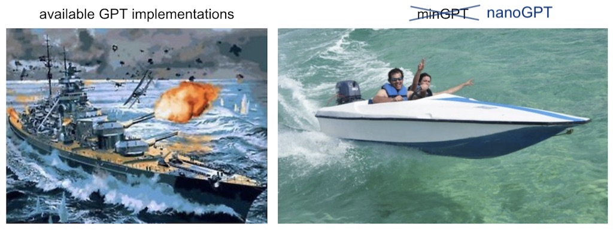
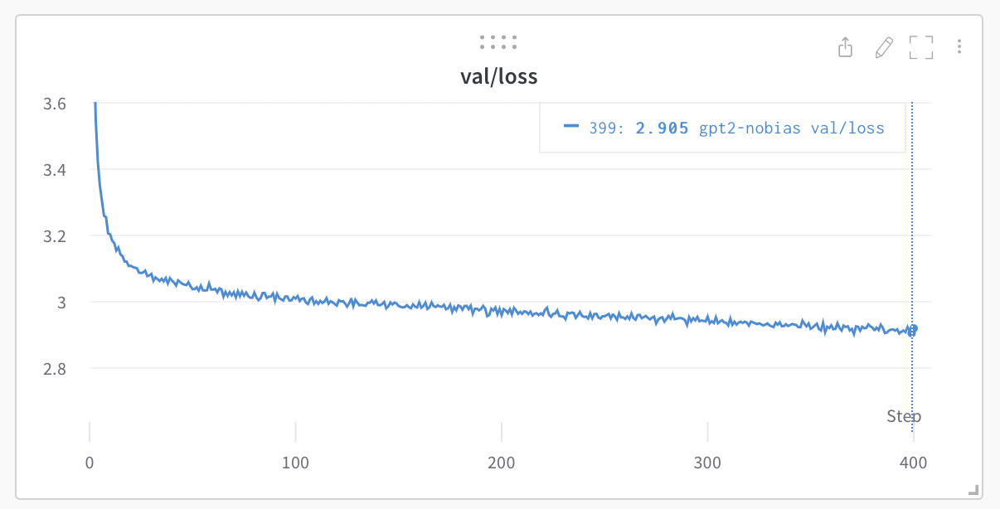

# nanoGPT




---

**Update Nov 2025** nanoGPT has a new and improved cousin called [nanochat](https://github.com/karpathy/nanochat). It is very likely you meant to use/find nanochat instead. nanoGPT (this repo) is now very old and deprecated but I will leave it up for posterity.

---

The simplest, fastest repository for training/finetuning medium-sized GPTs. It is a rewrite of [minGPT](https://github.com/karpathy/minGPT) that prioritizes teeth over education. Still under active development, but currently the file `train.py` reproduces GPT-2 (124M) on OpenWebText, running on a single 8XA100 40GB node in about 4 days of training. The code itself is plain and readable: `train.py` is a ~300-line boilerplate training loop and `model.py` a ~300-line GPT model definition, which can optionally load the GPT-2 weights from OpenAI. That's it.



Because the code is so simple, it is very easy to hack to your needs, train new models from scratch, or finetune pretrained checkpoints (e.g. biggest one currently available as a starting point would be the GPT-2 1.3B model from OpenAI).

## install

```
pip install torch numpy transformers datasets tiktoken wandb tqdm
```

Dependencies:

- [pytorch](https://pytorch.org) <3
- [numpy](https://numpy.org/install/) <3
-  `transformers` for huggingface transformers <3 (to load GPT-2 checkpoints)
-  `datasets` for huggingface datasets <3 (if you want to download + preprocess OpenWebText)
-  `tiktoken` for OpenAI's fast BPE code <3
-  `wandb` for optional logging <3
-  `tqdm` for progress bars <3

## quick start

If you are not a deep learning professional and you just want to feel the magic and get your feet wet, the fastest way to get started is to train a character-level GPT on the works of Shakespeare. First, we download it as a single (1MB) file and turn it from raw text into one large stream of integers:

```sh
python data/shakespeare_char/prepare.py
```

This creates a `train.bin` and `val.bin` in that data directory. Now it is time to train your GPT. The size of it very much depends on the computational resources of your system:

**I have a GPU**. Great, we can quickly train a baby GPT with the settings provided in the [config/train_shakespeare_char.py](config/train_shakespeare_char.py) config file:

```sh
python train.py config/train_shakespeare_char.py
```

If you peek inside it, you'll see that we're training a GPT with a context size of up to 256 characters, 384 feature channels, and it is a 6-layer Transformer with 6 heads in each layer. On one A100 GPU this training run takes about 3 minutes and the best validation loss is 1.4697. Based on the configuration, the model checkpoints are being written into the `--out_dir` directory `out-shakespeare-char`. So once the training finishes we can sample from the best model by pointing the sampling script at this directory:

```sh
python sample.py --out_dir=out-shakespeare-char
```

This generates a few samples, for example:

```
ANGELO:
And cowards it be strawn to my bed,
And thrust the gates of my threats,
Because he that ale away, and hang'd
An one with him.
